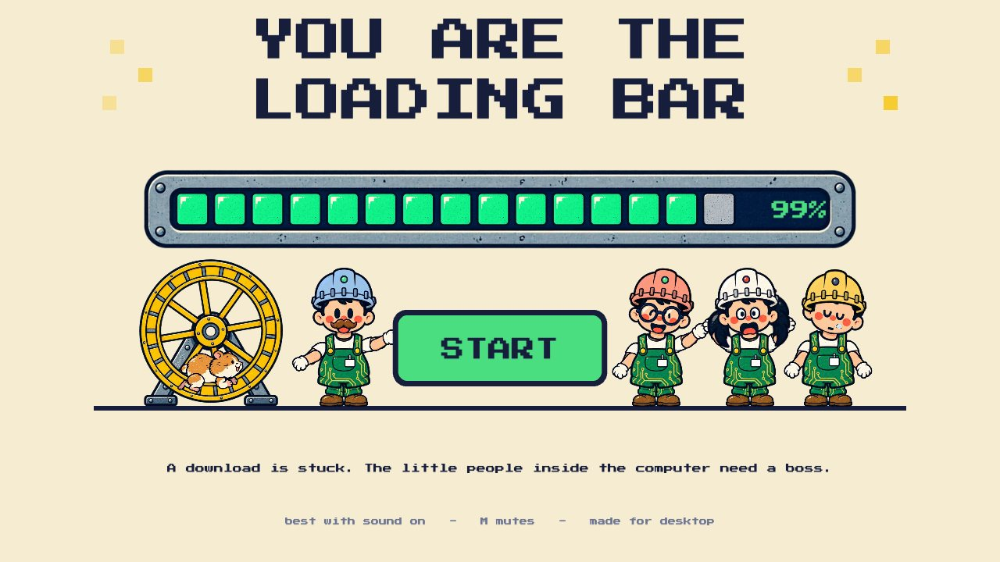
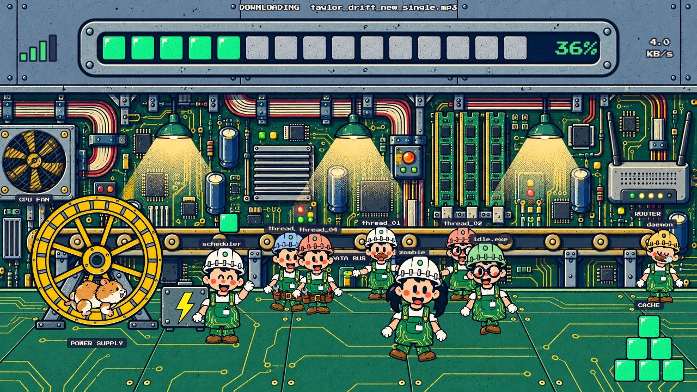
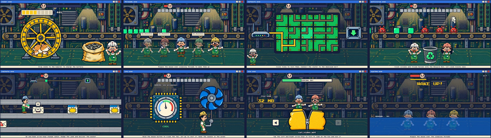
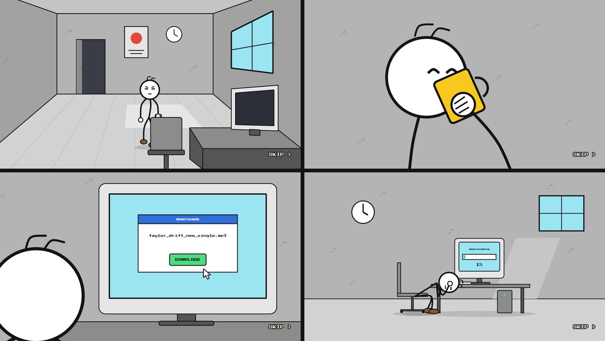
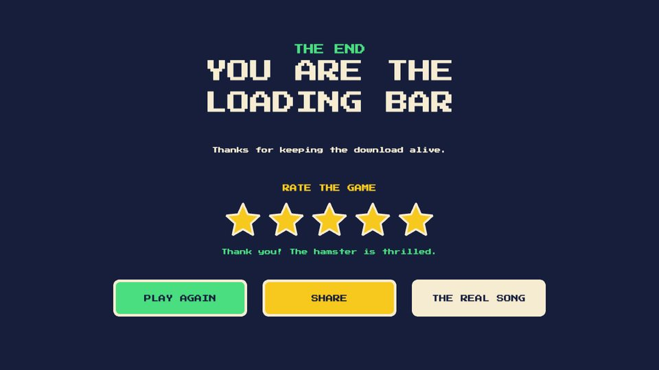

# You Are the Loading Bar

A short, silly browser game. A download is stuck at 1%. The camera dives into the computer, where a crew of little workers keeps the download moving, and you are their boss. Fix eight breakdowns and get the bar to 100%.

**[Play it in your browser](https://aayushgarg293.github.io/you-are-the-loading-bar/)** (desktop, about 10 to 15 minutes, best with sound on)



## The game

Every operation inside the computer is done by hand. A hamster on a wheel is the power supply, a conveyor belt is the data bus, and the workers are threads in microchip helmets. When something breaks, the line stops, the scheduler runs up with an error dialog, and you open the "program" that fixes it.



Each breakdown is a different quick minigame, played inside a retro program window. A patience meter fills while you work; if it fills up, the person outside the computer hits REFRESH and you start that minigame again.



| At | Program | What you do | Controls |
|---|---|---|---|
| 1% | `power.exe` | Feed the hamster to charge the battery | Drag |
| 12% | `threads.exe` | Wake workers who have frozen as "Not Responding" | Wiggle the mouse |
| 25% | `network.exe` | Turn circuit tiles to connect the router to the download port | Click |
| 40% | `antivirus.exe` | Bin viruses and Trojan horses, let clean blocks pass | Click |
| 55% | `packets.exe` | Run a packet down the cable, dodging pop-ups, spam and cookies | Up / Down |
| 70% | `cpu.exe` | Crank the fan to keep the processor out of the red, without freezing it | Hold the mouse |
| 85% | `zip.exe` | Jump on an oversized file until it zips shut | Left / Right in turn |
| 99% | `system.exe` | Seven six-second rounds of everything, while a blue screen creeps up | All of the above |

Press **M** at any time to mute.

The story around the game is a stick-figure cartoon: an opening where he trudges in, starts the download and slowly loses his mind, and an ending where he finally opens the file.



## How it is built

**Phaser 4, TypeScript and Vite.** The whole build is about 3 MB, and it is a static site with no server.

A few things that may be interesting if you are reading the code:

- **Characters are paper puppets.** A worker is a set of separate parts (head, helmet, torso, arms, legs) pinned together at joints and moved with tweens. There are no frame-by-frame animation sheets, so one small set of art gives every mood, a walk, carrying and a side view. See [`src/objects/Worker.ts`](src/objects/Worker.ts).
- **The game loop is a list of data.** [`src/data/problems.ts`](src/data/problems.ts) lists each breakdown: the percentage where the line stalls, which scene fixes it, and the error dialog's text. Adding a minigame is one new scene and one new entry.
- **Every minigame shares one base class.** [`src/scenes/MinigameScene.ts`](src/scenes/MinigameScene.ts) supplies the program window, the patience meter, the screen glitches, and the win and fail handling, so a minigame only builds its own screen.
- **The stick-figure world uses no images.** The figure is a handful of numbers (how far he leans, where each hand is) and a function that draws lines between the joints, with elbows found by two-bone inverse kinematics. Rooms are drawn in one-point perspective. See [`src/objects/StickFigure.ts`](src/objects/StickFigure.ts) and [`src/cutscene/`](src/cutscene/).
- **Cutscenes are timelines.** Each shot is a container; a cut hides one and shows the next; the camera pans and zooms for the "filmed" feel. See [`src/scenes/IntroScene.ts`](src/scenes/IntroScene.ts).
- **All sound is generated in code.** There are no audio files. Effects and music are built from a tone and a burst of noise using the Web Audio API. See [`src/audio/sound.ts`](src/audio/sound.ts).
- **A small art pipeline.** Raw art sheets live in `art-source/`. A script cuts out each named part, removes flat backgrounds, shrinks and packs them into texture atlases. See [`tools/build-atlas.mjs`](tools/build-atlas.mjs).

## Run it yourself

You need [Node.js](https://nodejs.org) 20 or newer.

```bash
npm install
npm run dev        # http://localhost:5273
```

Other commands:

```bash
npm run build      # typecheck, then build into dist/
npm run typecheck  # TypeScript only
npm run assets     # rebuild the atlases from art-source/
```

While developing, a **DEV** tab in the bottom-right corner (or the `` ` `` key) opens a menu that jumps straight to any minigame or cutscene. It is not included in the public build.

Every push to `main` is built and published to GitHub Pages by [`.github/workflows/deploy.yml`](.github/workflows/deploy.yml).

## Where things are

| Path | What it is |
|---|---|
| `src/scenes/` | One file per screen: title, intro, main screen, the eight minigames, ending, end screen |
| `src/objects/` | Reusable pieces: the worker puppets, hamster, loading bar, error dialog, stick figure |
| `src/factory/crew.ts` | The jobs the crew do on the main screen |
| `src/cutscene/` | The rooms, close-ups and video overlay used by the cutscenes |
| `src/audio/sound.ts` | Sound effects and music |
| `src/data/problems.ts` | The ordered list of breakdowns |
| `tools/` | The art pipeline |
| `art-source/` | Raw art, never shipped |
| `public/assets/` | Generated atlases |

## Credits and notes

- Designed by Aayush Garg. The code was written in conversation with [Claude Code](https://claude.com/claude-code).
- The worker, hamster, motherboard and prop art was generated with AI image tools from written prompts, then cut and packed by the script in this repository. The stick-figure cartoon and all interface elements are drawn in code.
- The ending plays a video through YouTube's own embedded player. No music or footage is included in this repository. If the video cannot play, the game shows its own version instead.
- The font is [Press Start 2P](https://fonts.google.com/specimen/Press+Start+2P).


